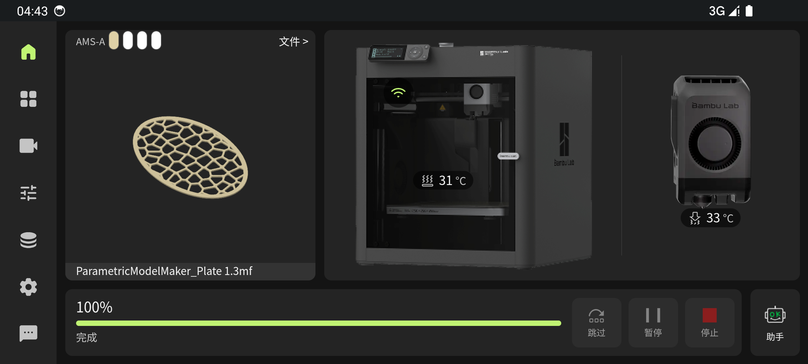
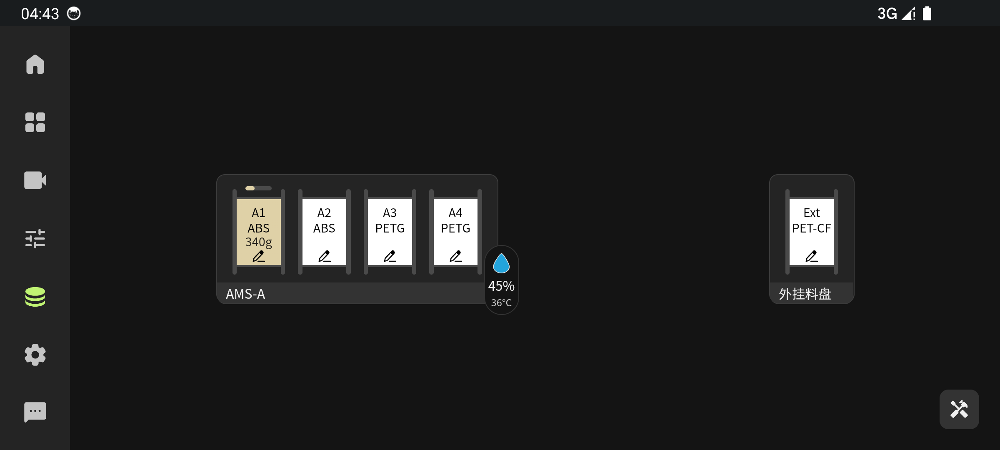
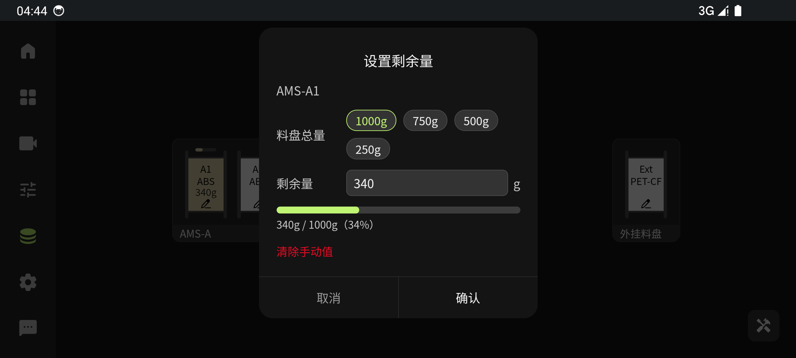
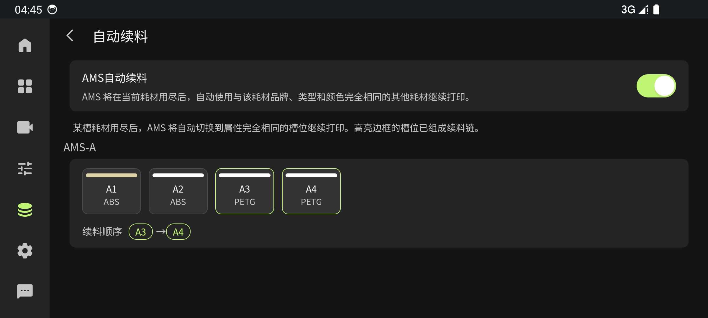
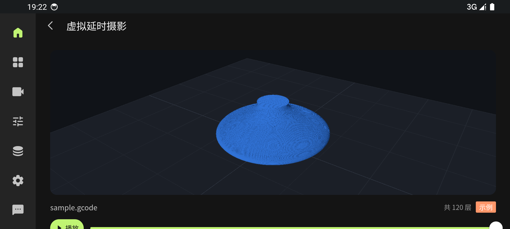

# Bambulab Screen

[English](./README.md) | [简体中文](./README.zh.md)

[](./LICENSE)
[](https://github.com/genomeic/bambulab-screen/actions/workflows/npm-build.yml)
[](https://github.com/genomeic/bambulab-screen/actions/workflows/android-build.yml)

A personal, feature-extended build of **P1Screen** — the control screen software for Bambu Lab P1 series printers.

Based on [0x5e/bambulab-p1screen](https://github.com/0x5e/bambulab-p1screen), with a set of features tailored to my own fleet (P1S ×2, H2D, A1, all cloud-connected).

## What's different from upstream

### Consumable tracking
- **Spool remaining amount** — manually enter the remaining grams of any AMS slot or the external spool; trays show `ABS · 340g` with a stacked layout
- **Auto-deduct after print** — when a print finishes normally, the spool that was loaded is reduced by the consumption reported by the cloud task (Bambu account required). Failed prints are never deducted, since their reported weight doesn't reflect real usage
- Global on/off switch in Settings

### Auto refill
- New **Auto Refill** page (Filament page → wrench menu): shows the AMS auto-refill switch and visualises which slots form a refill chain (slots with identical brand / type / colour / temperatures are linked, e.g. `A3 → A4`)

### Assistant (HMS)
- **Clear errors** button — wipes the printer's HMS error list with the official `clean_print_error` command, for stale errors left behind by cancelled prints

### Virtual timelapse (new)
- Replays a model's print process from its G-code as a layer-by-layer animation — no camera, no waiting for a real print
- Pick a `.3mf` / `.gcode` file in the file list → "Generate timelapse"; the print is rebuilt with real extrusion-width tube geometry (Bambu Studio compatible) in the active filament's colour, in an orbitable three-quarter chamber view
- **Export video** (8/15/30 s) as `.webm` to the phone's Downloads folder, ready to share

### Reliability
- **MQTT push coalescing** — printers push status up to dozens of times per second; the UI now coalesces data pushes (250 ms) while keeping print-state transitions instant. Fixes the heavy stutter on the filament page
- **Fleet switching fixes** — switching devices from the device popup / add / edit pages no longer drops devices from the overview
- Memory-cached spool bookkeeping (no localStorage parsing per render)

### Print gate
- Cloud-connected P1/P1S with firmware > 01.08 refuses unsigned print commands. The app detects this up front and shows a guide dialog instead of a silent failure (historic reprints, skip-objects, etc.)

## Screenshots

### Printing home with the AMS strip (new)
The AMS filament strip also shows on the printing/finished home page (upstream only had it on the idle page):



### Spool remaining amount (new)
Enter the remaining grams of any slot; trays display it right on the filament card (`ABS` / `340g` stacked), with a preset dialog and a live percentage meter:




### Auto refill (new)
Toggle the AMS auto-refill switch and see which slots are linked into a refill chain (`A3 → A4`, identical brand/type/colour/temperature):



### Virtual timelapse (new)
Rebuild the print process from a model's G-code and replay it layer by layer — exportable as video:



### Base UI (inherited from upstream)


## Installation

### Android app (recommended)

Grab the APK from the **Actions** tab → latest *Android Build* run → Artifacts.
You can also build it yourself (see [Building](#building)).

### Web

Deploy the backend service on any device in the same LAN as the printer (mainly MQTT forwarding):

```bash
npm install
npm run build
npm run start
```

Then add a full-screen home screen shortcut pointing at `http://<server-address>:8888/`.

## Building

```bash
# frontend
cd frontend
npm install
npm run build

# android (output: android/app/build/outputs/apk/debug/app-debug.apk)
cd ../android
./gradlew assembleDebug
```

Or push to `main` and let GitHub Actions build the APK in the cloud
(`Android Build` workflow, also manually dispatchable).

## Known limitations

- Firmware > 01.08 on cloud-connected P1/P1P/P1S **signs** MQTT commands; unsigned third-party commands are rejected with `err_code 84033543`. Affected: starting/reprinting prints, skip-objects, some AMS setting switches. The app detects and guides around the most common ones; the rest must be done on the printer screen or via Bambu Handy.
- Auto-deduct requires a logged-in Bambu account (cloud task weight).

## Acknowledgements

- [0x5e/bambulab-p1screen](https://github.com/0x5e/bambulab-p1screen) — the base project. Almost all of the core UI/UX is upstream's work.
- [OpenBambuAPI](https://github.com/Doridian/OpenBambuAPI/) — LAN protocol docs
- [Bambu Lab](https://bambulab.com) for the printers (and for keeping the MQTT protocol open enough to build on)

## License

[MIT](./LICENSE)
